# 실험 기록

`exp/model-selection` 브랜치의 모델 선택 실험을 진행 순서대로 정리한 기록입니다. 그림은 `analysis/figures/`에 있습니다.
데이터 개요와 노이즈 분석은 `analysis/overview` 브랜치에 있습니다.

공통 사항
- 데이터: train 50,000개 (x ∈ [0.0003, 10.0000]), test 10,000개 (x ∈ [0.0003, 11.9998])
- seed 42
- 다항식 표준화: z = (x − 5) / 5 (x ∈ [0, 10] → z ∈ [−1, 1]), 별도 표기가 없으면 이 값 사용
- "lstsq"는 `np.linalg.lstsq`(최소제곱, 정규방정식과 같은 해)로 구한 값이며 비교 기준으로만 사용

---

## 1. baseline (1차 모델)

설정: `configs/baseline.toml` (LinearModel, MSE, SGD lr 0.01, batch 256, 100 epoch, 5-fold)

| 항목 | 값 |
|---|---|
| 5-fold CV val RMSE | 2.0221 ± 0.0198 |
| 전체 train MSE | 4.0771 |
| 파라미터 [θ₀, θ₁] | [−2.9588, 0.6443] |

---

## 2. 다항식: lstsq 기준 CV RMSE (대화 중 계산, 스크립트 없음)

Legendre 기저, 5-fold (`KFold(5, seed=42)`와 같은 분할), f(12)는 전체 train으로 구한 계수로 계산

| 차수 | CV RMSE | f(12) |
|---|---|---|
| 3 | 0.6242 ± 0.0022 | −17.9 |
| 5 | 0.5206 ± 0.0020 | −10.4 |
| 8 | 0.4665 ± 0.0026 | −75.4 |
| 10 | 0.3342 ± 0.0009 | 1,626.5 |
| 12 | 0.2312 ± 0.0010 | −4,792.8 |
| 15 | 0.2015 ± 0.0010 | 19,024.5 |
| 18 | 0.2003 ± 0.0009 | −21,181.6 |
| 20 | 0.2003 ± 0.0009 | −6,684.5 |
| 25 | 0.2003 ± 0.0009 | −2,733,288 |
| 30 | 0.2004 ± 0.0009 | 291,274,239 |

전체 train으로 구한 lstsq 곡선:

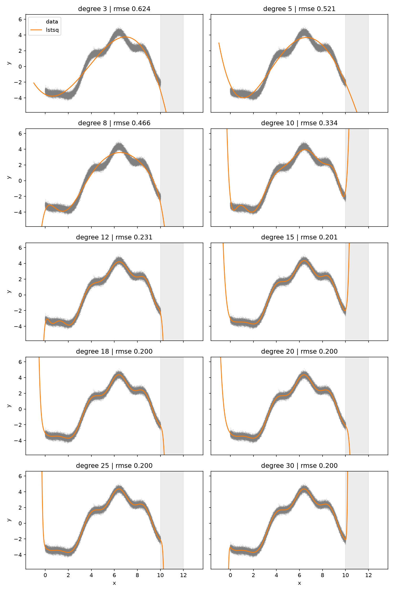

---

## 3. 다항식: GD 수렴 테스트 (15차, 대화 중 계산, 스크립트 없음)

`PolynomialModel(degree=15)` (단항식 기저 zᵏ, 초기값 0), 전체 train, CV 없음

| 설정 | 학습량 | RMSE 10% / 50% / 최종 | 시간 |
|---|---|---|---|
| lstsq 기준 | — | 0.2014 | — |
| Adam full-batch lr 0.05 | 5,000 step | 0.549 / 0.469 / 0.449 | 194s |
| Adam full-batch lr 0.1 | 5,000 step | 0.498 / 0.456 / 0.439 | 195s |
| Adam batch 1024 lr 0.01 | 200 epoch | 0.769 / 0.488 / 0.462 | 15s |
| Adam batch 256 lr 0.005 | 60 epoch | 0.943 / 0.502 / 0.481 | 10s |
| Momentum full-batch lr 0.05 | 5,000 step | 0.527 / 0.483 / 0.477 | 193s |

단항식 설계행렬 조건수: 15차 2.3 × 10⁵, 18차 3.1 × 10⁶

---

## 4. 다항식: 차수별 5-fold CV (실제 파이프라인)

- config: `configs/exp/poly_d{3,5,8,10,12,15,18,20}.toml`
- `PolynomialModel` (center 5, scale 5, 초기값 0), MSE, Adam lr 0.01, batch 1024, 200 epoch, 5-fold
- 실행: `uv run python main.py --config configs/exp/poly_d{d}.toml`

| 차수 | CV val RMSE | 전체 train MSE | 시간 |
|---|---|---|---|
| 3 | 0.6245 ± 0.0023 | 0.3897 | 45s |
| 5 | 0.5207 ± 0.0020 | 0.2710 | 59s |
| 8 | 0.4710 ± 0.0029 | 0.2206 | 60s |
| 10 | 0.4721 ± 0.0025 | 0.2223 | 63s |
| 12 | 0.4752 ± 0.0023 | 0.2221 | 67s |
| 15 | 0.4706 ± 0.0024 | 0.2139 | 75s |
| 18 | 0.4507 ± 0.0031 | 0.1982 | 86s |
| 20 | 0.4464 ± 0.0031 | 0.1972 | 94s |

전체 train으로 학습한 최종 모델 (스크립트: `analysis/poly_fit.py`):

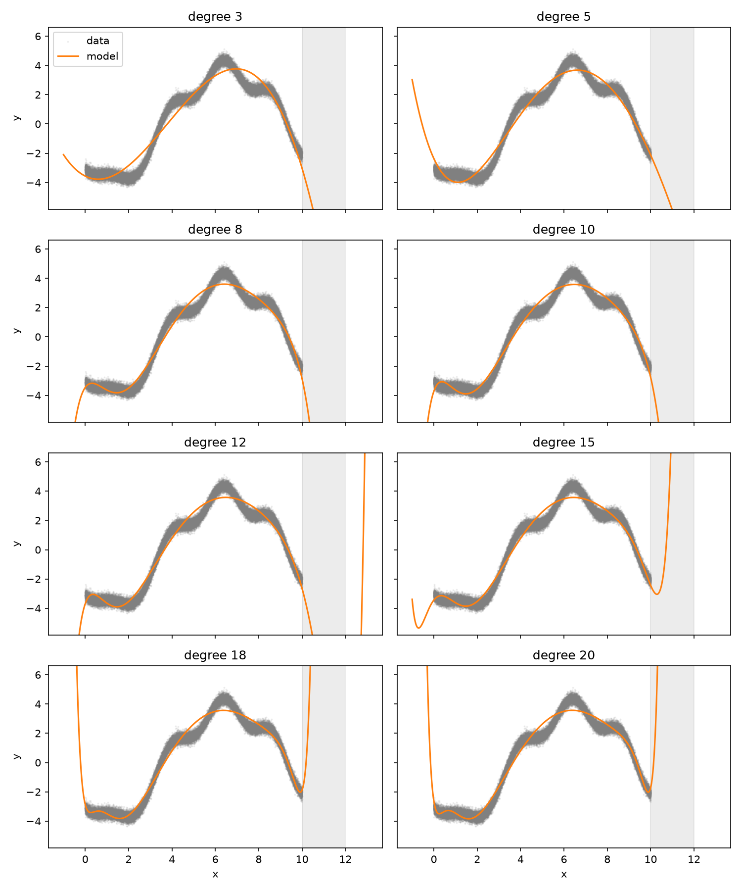

---

## 5. 다항식: GD 조합 실험

스크립트: `analysis/poly_sweep.py` (`--sweep optimizer|budget|degree`), 전체 train, 초기값 0, MSE, center 5.
그림의 점선은 같은 차수의 lstsq 곡선. 수치는 `outputs/poly_sweep/*.json`.

### 5-A. optimizer × lr (20차, batch 1024, 500 epoch, scale 5)

| optimizer | lr | train RMSE |
|---|---|---|
| SGD | 0.01 / 0.05 | 0.5242 / 0.4817 |
| Momentum | 0.005 / 0.01 | 0.4817 / 0.4630 |
| Nesterov | 0.005 / 0.01 | 0.4817 / 0.4630 |
| Adagrad | 0.1 / 0.5 | 0.4916 / 0.4429 |
| RMSProp | 0.001 / 0.01 | 0.4588 / 0.4414 |
| Adam | 0.01 / 0.05 | 0.4391 / 0.4285 |

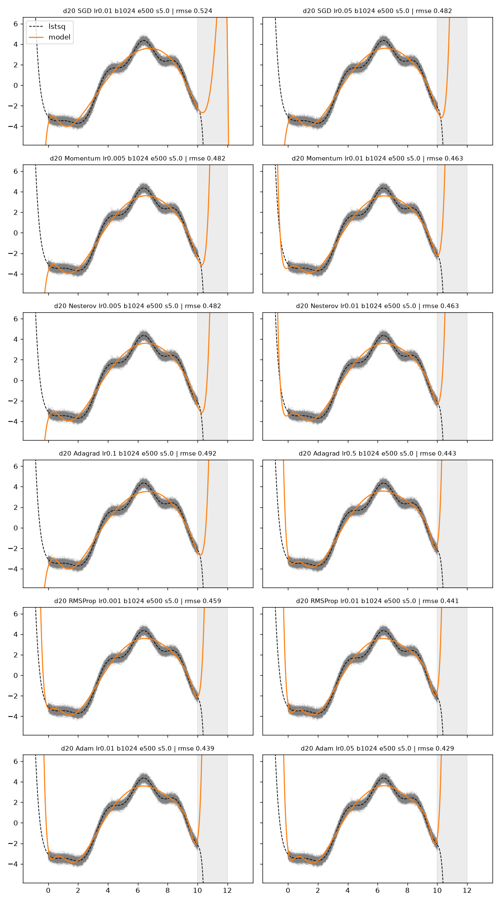
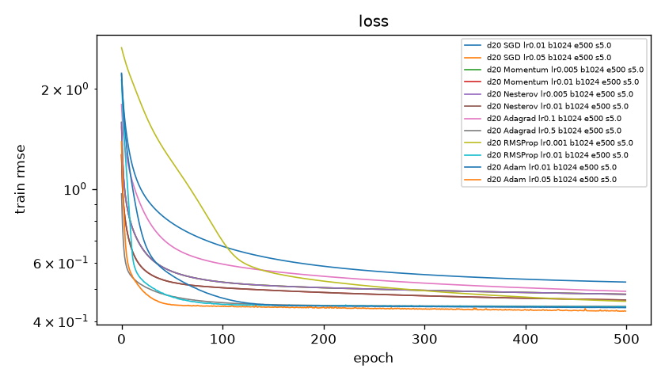

### 5-B. batch × epoch (20차, Adam lr 0.01, scale 5)

| batch | epoch | train RMSE | 시간 |
|---|---|---|---|
| 256 | 200 | 0.4399 | 31s |
| 256 | 1000 | 0.4222 | 142s |
| 1024 | 200 | 0.4440 | 18s |
| 1024 | 2000 | 0.4247 | 177s |
| 4096 | 500 | 0.4475 | 30s |
| 4096 | 4000 | 0.4282 | 240s |

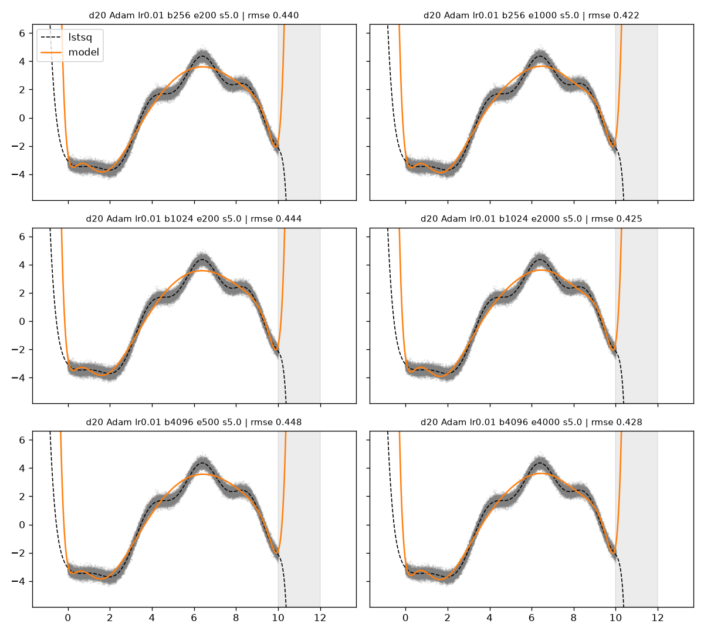
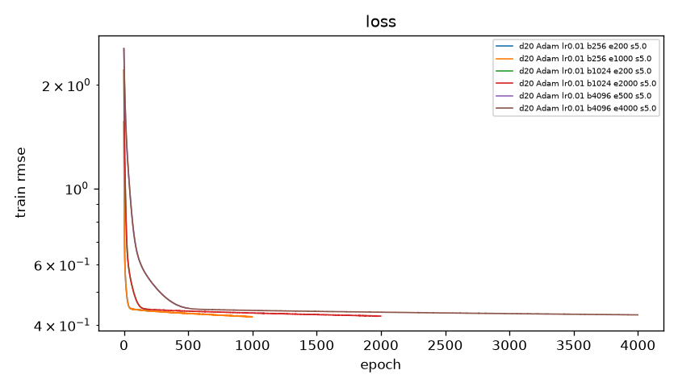

### 5-C. 차수 × scale (Adam lr 0.01, batch 1024, 1000 epoch)

| 차수 | scale 5.0 | scale 2.887 |
|---|---|---|
| 10 | 0.4650 | 0.4236 |
| 15 | 0.4355 | 0.4234 |
| 20 | 0.4338 | 17.8397 |
| 25 | 0.4324 | 0.7009 |

- scale 2.887은 z ∈ [−1.73, 1.73]
- 20차·25차 scale 2.887은 학습 내내 train RMSE가 10¹ ~ 10³까지 튀는 진동

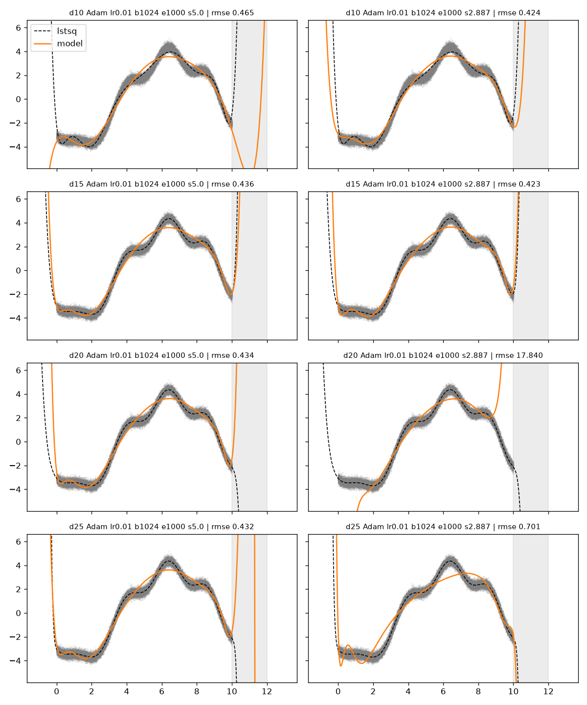
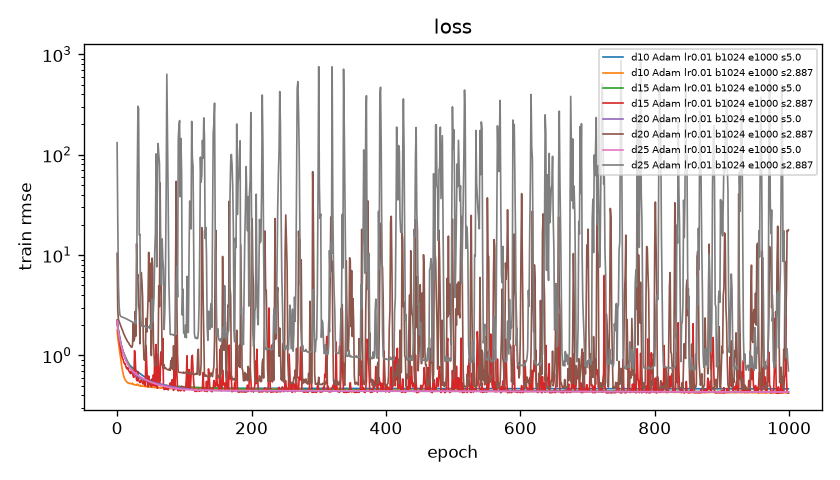

---

## 6. 조건수 비교 (대화 중 계산, 스크립트 없음)

### 6-1. 항 구성별 (z ∈ [−1, 1], train x)

| 항 구성 | 항 수 | cond(B) | lstsq RMSE |
|---|---|---|---|
| 0..15 | 16 | 2.3e5 | 0.2014 |
| 0..20 | 21 | 1.8e7 | 0.2003 |
| 0..10 + 15, 20 | 13 | 7.1e3 | 0.2574 |
| 0,1,2,3,5,8,13,21 | 8 | 1.9e2 | 0.5591 |
| 0,1,2,4,8,16 | 6 | 1.4e2 | 1.1989 |
| 짝수 0..20 + 1 | 12 | 1.8e7 | 1.1324 |
| Legendre 0..20 | 21 | 6.4 | — |

### 6-2. 점 개수별 (단항식 기저)

| x 위치 | 15차 cond(B) / cond(BᵀB) | 20차 cond(B) / cond(BᵀB) |
|---|---|---|
| train 50,000개 | 2.30e5 / 5.28e10 | 1.77e7 / 3.13e14 |
| 균일 격자 500개 | 2.26e5 / 5.11e10 | 1.73e7 / 3.01e14 |
| 균일 격자 50개 | 2.31e5 / 5.32e10 | 2.17e7 / 4.67e14 |
| 균일 격자 30개 | 2.98e5 / 8.88e10 | 4.97e7 / 2.24e15 |

---

## 7. 20차 lstsq 모델의 극점·변곡점

스크립트: `analysis/critical_points.py`

| 종류 | x |
|---|---|
| 극점 (f′ = 0) | 0.5950, 0.9835, 1.9658, 4.5270, 4.6137, 6.3954, 7.8184, 8.2725 |
| 변곡점 (f″ = 0, 부호 변화 확인) | 0.7781, 1.5720, 3.2125, 4.5703, 5.6815, 7.0363, 8.0495, 9.2934, 9.9313 |

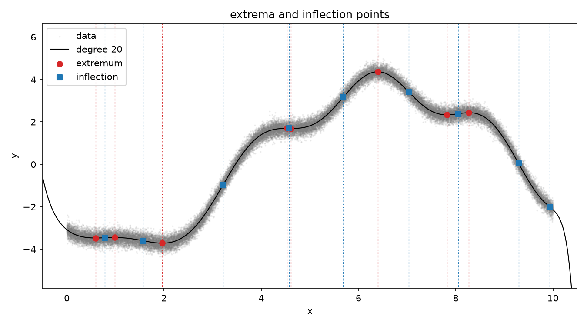

---

## 8. 극점 + 양 끝점 natural cubic spline

스크립트: `analysis/stationary_spline.py`. 노드 10개(양 끝점 + 극점 8개), 노드 y값은 20차 lstsq 값.

- spline train RMSE: 0.2906

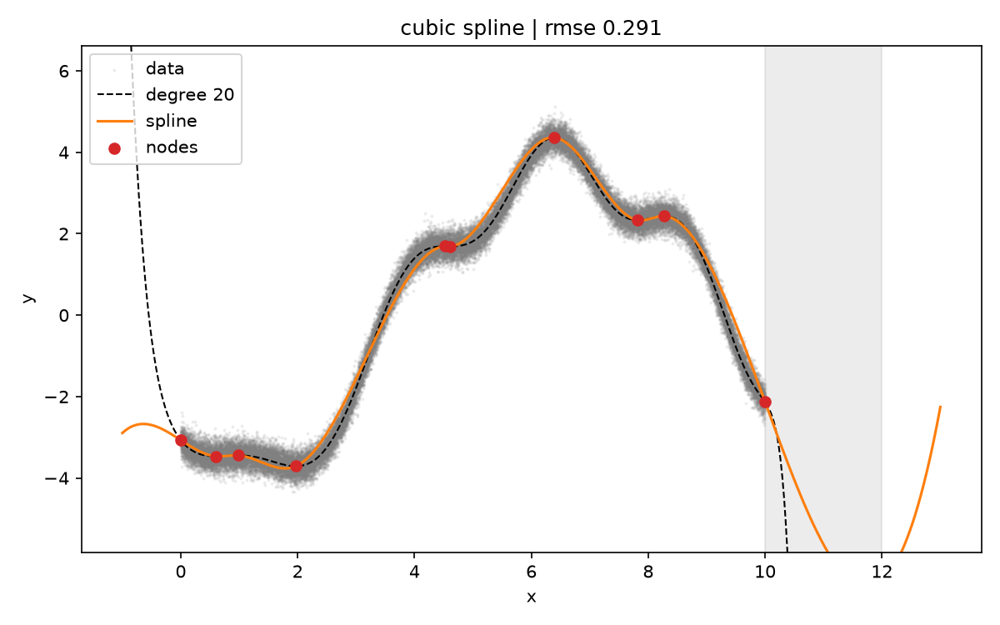

---

## 9. 구간별 3차 다항식 (GD)

스크립트: `analysis/piecewise_cubic.py` (`--nodes extrema|inflection|both`, `--min-width`)

- 구간마다 `PolynomialModel(degree=3)`, z = (x − 구간 중심) / 구간 반폭, 초기값 0
- MSE, Adam lr 0.05, full-batch 1000 step
- 구간 간 연속 조건 없음
- 그림: 자기 구간은 실선, 나머지 x 범위는 같은 색 점선

| 분할 | 구간 수 | 전체 train RMSE | 마지막 구간 (샘플 수) |
|---|---|---|---|
| 극점 | 9 | 0.2020 | [8.273, 10.000] (8,531) |
| 변곡점 | 10 | 0.2005 | [9.931, 10.000] (312) |
| 극점 + 변곡점 | 18 | 0.2002 | [9.931, 10.000] (312) |
| 변곡점, 폭 0.2 미만 구간 병합 | 9 | 0.2005 | [9.293, 10.000] (3,432) |

모든 구간에서 GD RMSE와 같은 구간 lstsq RMSE가 소수점 넷째 자리까지 같음.

### 9-1. 극점 기준

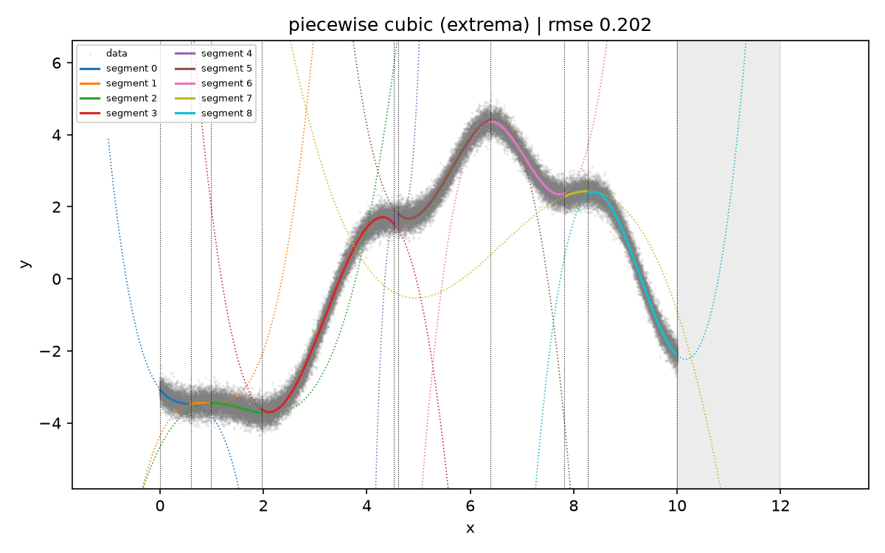
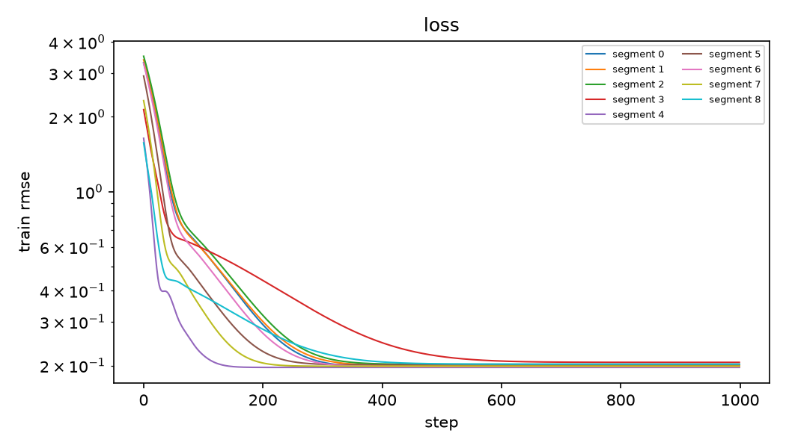

### 9-2. 변곡점 기준

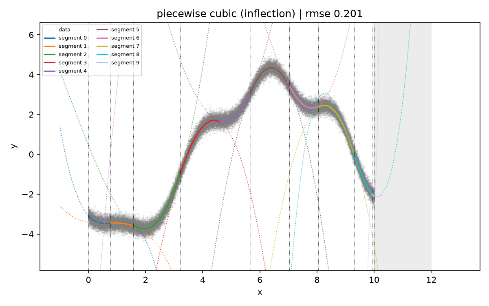
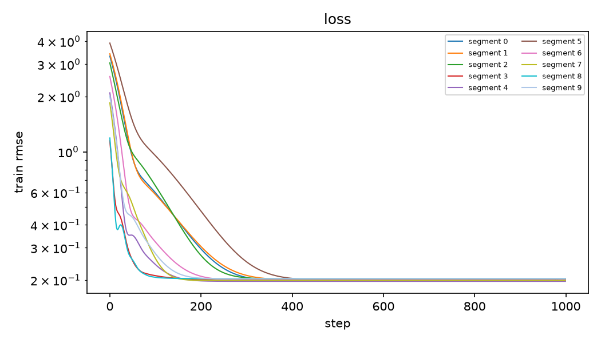

### 9-3. 극점 + 변곡점 기준

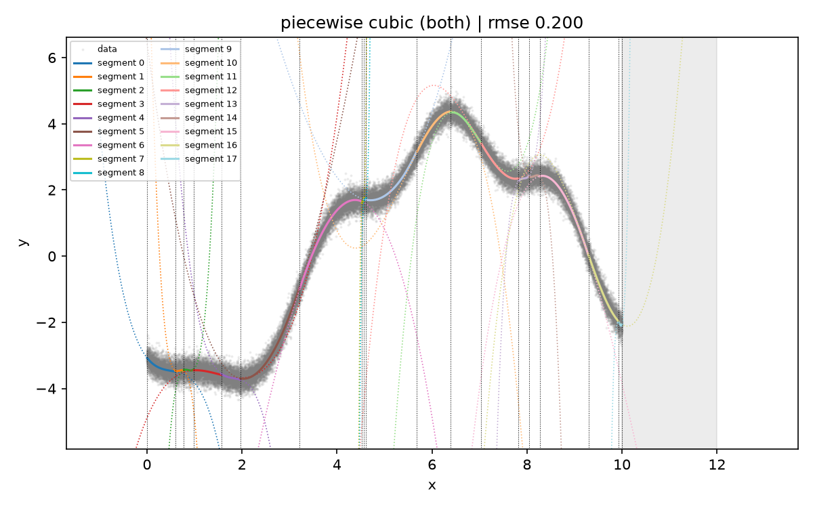
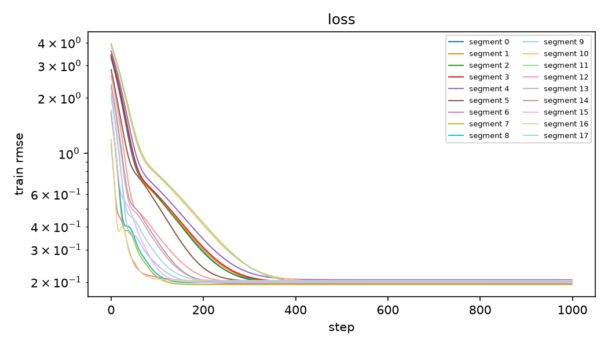

### 9-4. 변곡점 기준, 폭 0.2 미만 구간 병합

병합 규칙: 가장 좁은 구간부터, 양쪽 이웃 중 더 좁은 쪽과 합침(끝 구간은 안쪽 이웃과). 결과적으로 [9.931, 10.000]이 [9.293, 9.931]과 합쳐짐.

| 구간 | 샘플 수 | train RMSE |
|---|---|---|
| [0.000, 0.778] | 3,831 | 0.1977 |
| [0.778, 1.572] | 4,058 | 0.2004 |
| [1.572, 3.213] | 8,189 | 0.2032 |
| [3.213, 4.570] | 6,981 | 0.2021 |
| [4.570, 5.681] | 5,562 | 0.1970 |
| [5.681, 7.036] | 6,548 | 0.2000 |
| [7.036, 8.049] | 5,166 | 0.2000 |
| [8.049, 9.293] | 6,233 | 0.1992 |
| [9.293, 10.000] | 3,432 | 0.2039 |

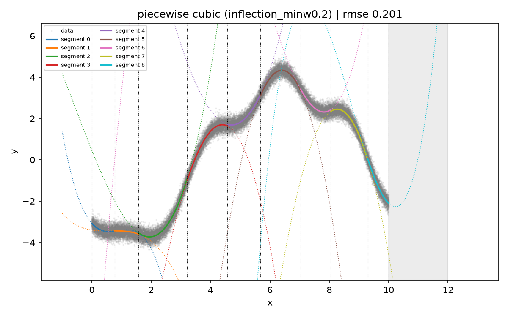
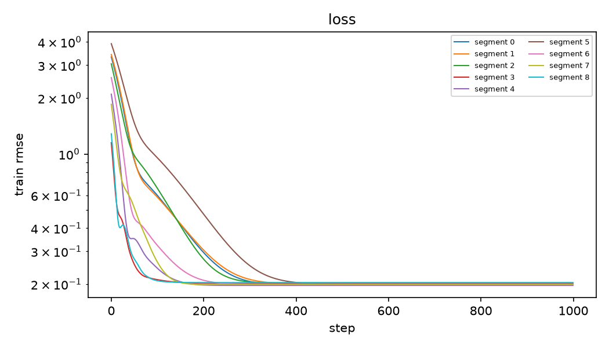

---

## 10. 구간별 지수함수 (GD)

스크립트: `analysis/piecewise_exp.py`

- 노드: 양 끝점 + 극점 8개 + 변곡점 9개 → 구간 18개
- 구간마다 y = a + b·e^(c·t), t = (x − 구간 왼쪽) / 구간 폭
- 초기값: c = sign(f′)·sign(f″) (구간 중앙, 20차 lstsq 기준), a·b는 구간 양 끝 lstsq 값을 지나도록
- MSE, Adam lr 0.05, full-batch 2000 step

| 항목 | 값 |
|---|---|
| 전체 train RMSE | 0.2027 |
| 구간별 train RMSE 범위 | 0.1944 ~ 0.2098 |

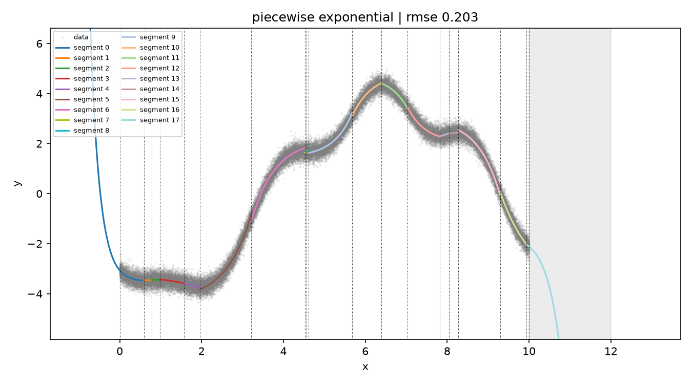
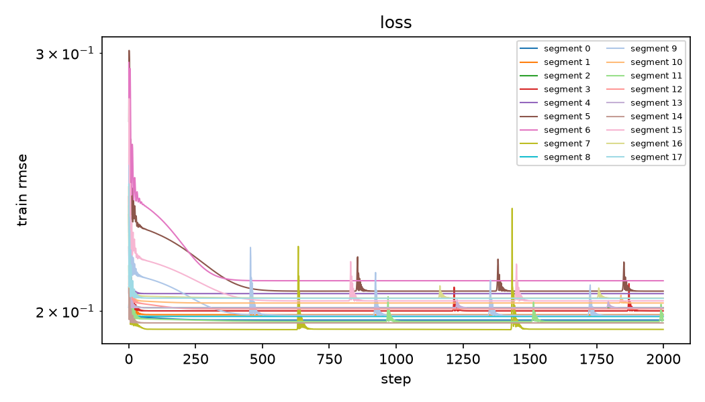

---

## 11. 구간 경계 겹침 학습 (변곡점 기준, 폭 0.2 미만 병합)

스크립트: `analysis/piecewise_cubic.py --nodes inflection --min-width 0.2 --overlap δ`

- 구간마다 학습 데이터는 [left − δ, right + δ] (데이터 끝에서는 안쪽만), 예측·평가는 원래 구간 [left, right]에만 사용
- 그 외 설정은 9장과 같음 (3차, Adam lr 0.05, full-batch 1000 step, 초기값 0)
- 점프: 각 내부 노드에서 왼쪽 구간 3차식과 오른쪽 구간 3차식 값의 차이의 절댓값
- "own rmse"는 원래 구간 샘플에 대한 RMSE, lstsq는 같은 겹침 학습 데이터로 구한 해를 원래 구간에서 평가한 값

| δ | 전체 train RMSE | 점프 평균 | 점프 최대 |
|---|---|---|---|
| 0 | 0.2005 | 0.0663 | 0.0998 |
| 0.1 | 0.2011 | 0.0070 | 0.0217 |
| 0.2 | 0.2027 | 0.0525 | 0.0717 |
| 0.3 | 0.2054 | 0.1047 | 0.1470 |

노드별 점프

| 노드 x | δ = 0 | δ = 0.1 | δ = 0.2 | δ = 0.3 |
|---|---|---|---|---|
| 0.7781 | 0.0085 | 0.0005 | 0.0061 | 0.0084 |
| 1.5720 | 0.0601 | 0.0052 | 0.0248 | 0.0643 |
| 3.2125 | 0.0998 | 0.0217 | 0.0665 | 0.1470 |
| 4.5703 | 0.0807 | 0.0034 | 0.0626 | 0.1213 |
| 5.6815 | 0.0799 | 0.0067 | 0.0696 | 0.1383 |
| 7.0363 | 0.0701 | 0.0025 | 0.0706 | 0.1422 |
| 8.0495 | 0.0815 | 0.0111 | 0.0717 | 0.1328 |
| 9.2934 | 0.0499 | 0.0047 | 0.0481 | 0.0836 |

구간별 own RMSE

| 구간 | δ = 0 | δ = 0.1 | δ = 0.2 | δ = 0.3 |
|---|---|---|---|---|
| [0.000, 0.778] | 0.1977 | 0.1977 | 0.1977 | 0.1977 |
| [0.778, 1.572] | 0.2004 | 0.2004 | 0.2004 | 0.2004 |
| [1.572, 3.213] | 0.2032 | 0.2041 | 0.2067 | 0.2109 |
| [3.213, 4.570] | 0.2021 | 0.2028 | 0.2045 | 0.2075 |
| [4.570, 5.681] | 0.1970 | 0.1974 | 0.1984 | 0.2000 |
| [5.681, 7.036] | 0.2000 | 0.2009 | 0.2041 | 0.2094 |
| [7.036, 8.049] | 0.2000 | 0.2005 | 0.2015 | 0.2035 |
| [8.049, 9.293] | 0.1992 | 0.2001 | 0.2023 | 0.2062 |
| [9.293, 10.000] | 0.2039 | 0.2040 | 0.2040 | 0.2040 |

δ = 0 그림은 9-4와 같습니다.

### δ = 0.1

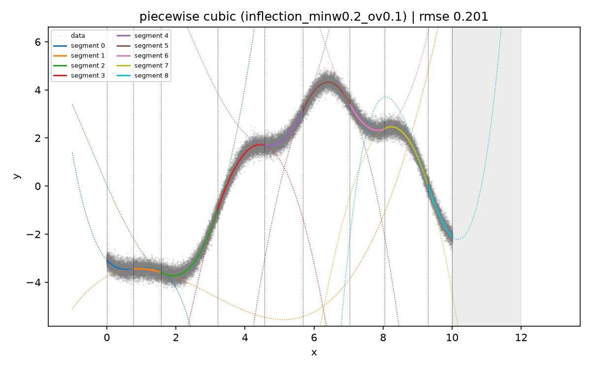
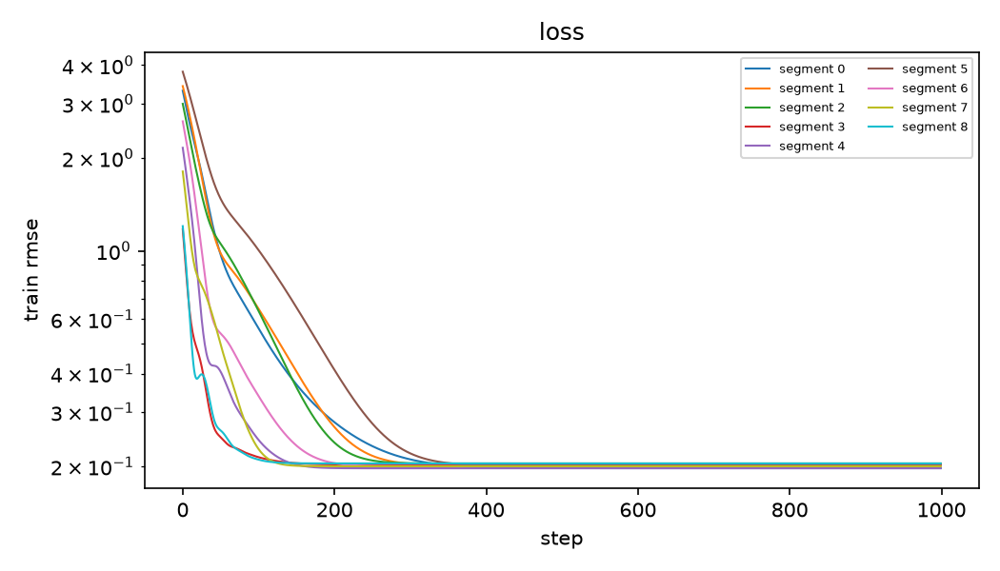

### δ = 0.2

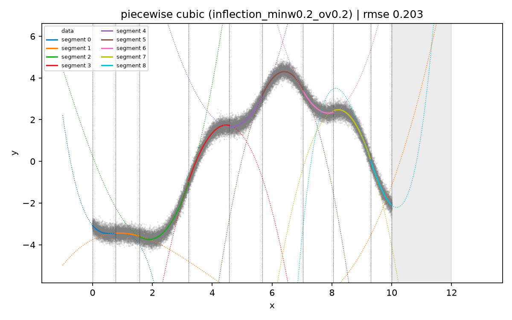
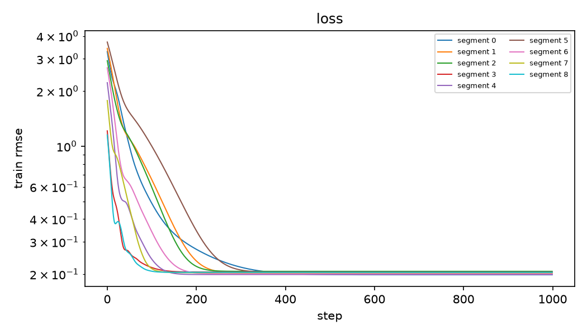

### δ = 0.3

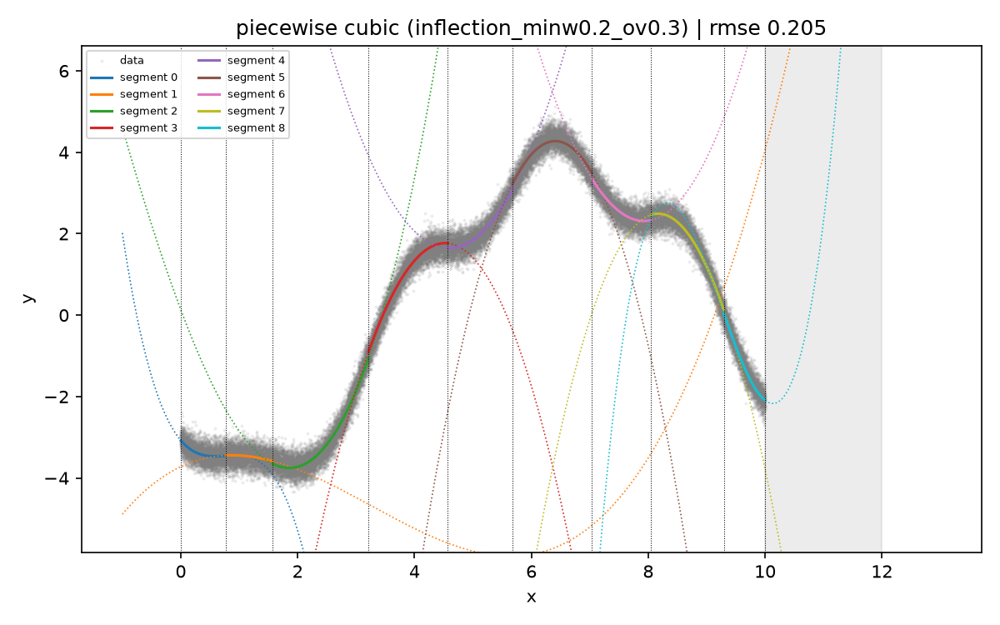
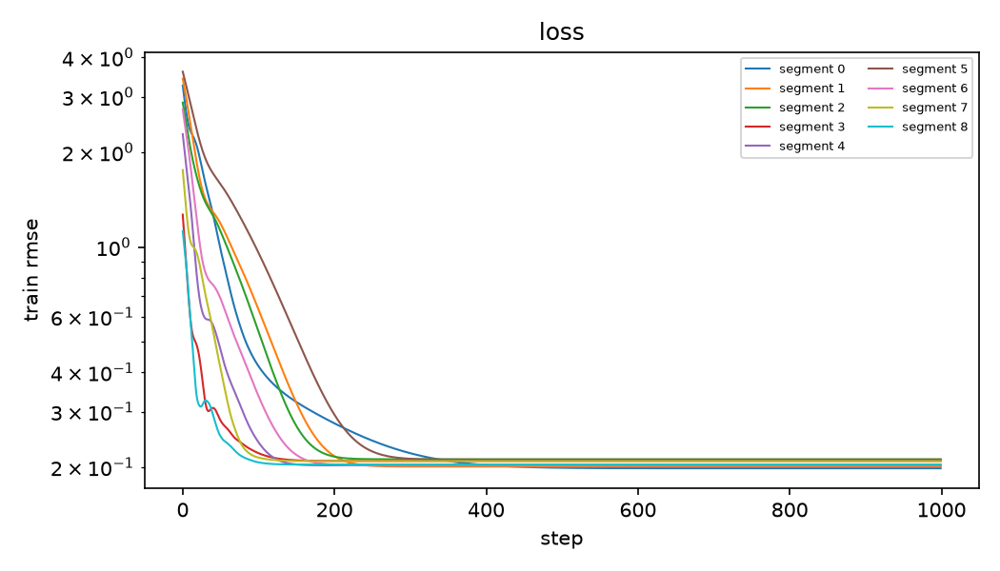

---

## 12. phase 1 제출 설계 (외삽 구간 탐색)

스크립트: `analysis/probe_phase1.py` (`uv run python -m analysis.probe_phase1`)

- 목적: x ∈ (10, 12] 곡선이 수평으로 이어지는지, 올라가는지, 내려가는지 리더보드 점수로 비교
- x ≤ 10: 11장 δ = 0.1 모델(변곡점, 폭 0.2 미만 병합)의 test 예측
  - `uv run python -m analysis.piecewise_cubic --nodes inflection --min-width 0.2 --overlap 0.1 --save-predictions`
  - 저장 위치: `outputs/piecewise_cubic/inflection_minw0.2_ov0.1_test.csv`
- x > 10: 시작값 f(10)에서 기울기만 다른 직선 3개
  - f(10) = −2.1440: train x ≥ 9.7 구간 직선 회귀의 x = 10 값 (같은 회귀의 기울기 −2.1749)
- 세 제출 파일의 x ≤ 10 예측은 비트 단위로 같음

| 제출 파일 | x > 10 | x = 12에서 값 |
|---|---|---|
| `submissions/20261126_1_phase1_flat.csv` | −2.1440 | −2.14 |
| `submissions/20261126_2_phase1_up.csv` | −2.1440 + (x − 10) | −0.14 |
| `submissions/20261126_3_phase1_down.csv` | −2.1440 − (x − 10) | −4.14 |

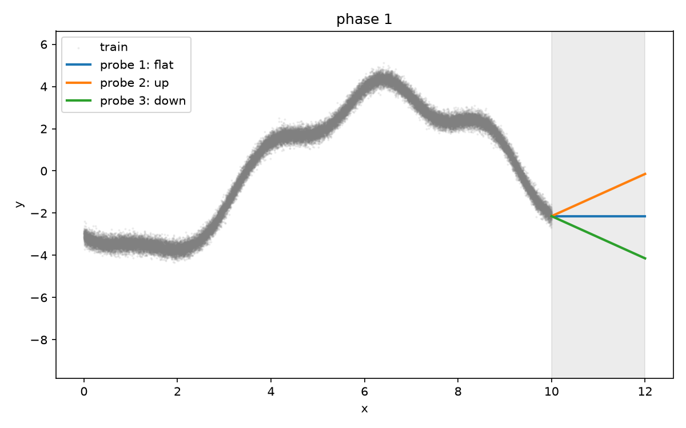

제출 결과(public RMSE)는 main 브랜치의 `submissions/log.md`에 기록합니다.
