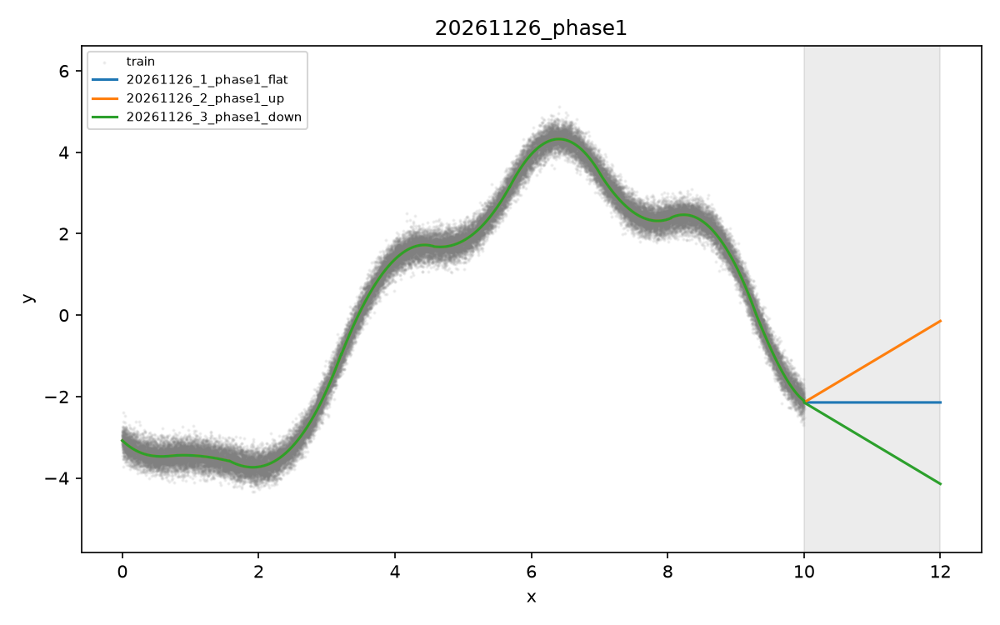
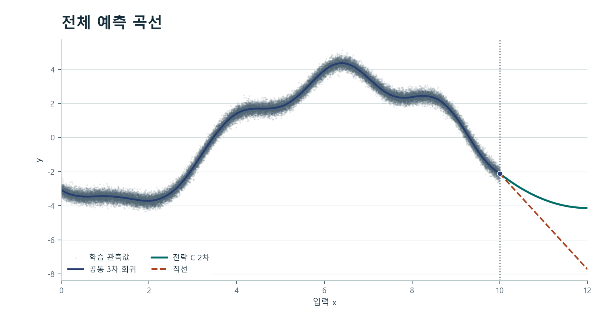
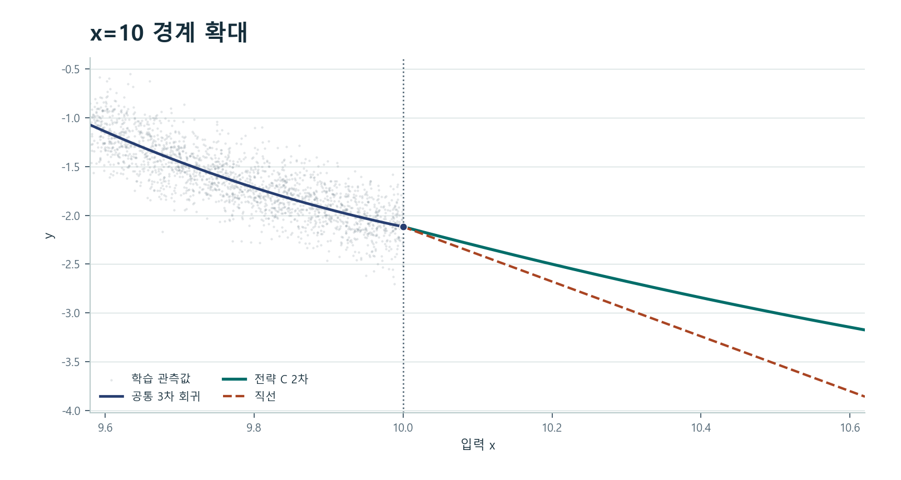

# 제출 기록

- 제출 파일: `submissions/YYYYMMDD_번호_이름.csv`
- 그림: `uv run python plot_submission.py <csv...>` → `submissions/figures/<파일이름>.png`, 여러 개를 겹칠 때는 `--overlay <이름>`

## 제출 목록

| # | 날짜 | 파일 | 생성 브랜치 (커밋) | x ≤ 10 | x > 10 | public RMSE |
|---|---|---|---|---|---|---|
| 1 | 2026-11-26 | `20261126_1_phase1_flat.csv` | `exp/model-selection` (`5934084`) | 구간별 3차식 | −2.1440 | 0.88862 |
| 2 | 2026-11-26 | `20261126_2_phase1_up.csv` | `exp/model-selection` (`5934084`) | 구간별 3차식 | −2.1440 + 1·(x − 10) | 1.40438 |
| 3 | 2026-11-26 | `20261126_3_phase1_down.csv` | `exp/model-selection` (`5934084`) | 구간별 3차식 | −2.1440 − 1·(x − 10) | |
| 4 | 2026-11-27 | `20261127_2_strategy_c.csv` | `exp/strategy-c` | 균등 20구간 3차식 | 경계에서 이어지는 2차식 | 0.36045 |

## 2026-11-26 phase 1

### 공통: x ≤ 10 예측
- 모델: 구간별 3차 다항식, 변곡점 기준 분할, 폭 0.2 미만 구간 병합, 경계 겹침 δ = 0.1
  - `uv run python -m analysis.piecewise_cubic --nodes inflection --min-width 0.2 --overlap 0.1 --save-predictions`
  - 노드: 0.0003, 0.7781, 1.5720, 3.2125, 4.5703, 5.6815, 7.0363, 8.0495, 9.2934, 10.0000
  - 구간마다 `PolynomialModel(degree=3)`, MSE, Adam lr 0.05, full-batch 1000 step, 초기값 0
  - train RMSE 0.2011, 노드 점프 평균 0.0070 / 최대 0.0217
- 세 제출 파일의 x ≤ 10 예측은 비트 단위로 같음

### x > 10 예측
- `uv run python -m analysis.probe_phase1`
- 시작값 f(10) = −2.1440: train x ≥ 9.7 구간 직선 회귀의 x = 10 값 (같은 회귀의 기울기 −2.1749)
- 기울기 0, +1, −1 직선 (제출 순서: flat, up, down)



### 결과

| 파일 | public RMSE |
|---|---|
| `20261126_1_phase1_flat.csv` | 0.88862 |
| `20261126_2_phase1_up.csv` | 1.40438 |
| `20261126_3_phase1_down.csv` | |

## 2026-11-27 전략 C

- `x ≤ 10`은 폭 0.5의 균등 20구간을 각각 3차 회귀로 학습했다. 학습 구간은 양옆으로 0.1만큼 넓혔고, 전체 배치 Adam을 학습률 0.05로 1,000번 적용했다.
- `x > 10`은 `t = (x - 10) / 2`, `ŷ = a + b(t - t²/2)`로 예측했다. `a = −2.11724854`는 마지막 3차식의 경계 예측값이고, `b = −4.03895793`은 `8 ≤ x ≤ 10`의 데이터에 전체 배치 GD를 학습률 0.1로 1,200번 적용해 얻었다. 경계에서 예측값이 이어지고 x=12에서 기울기가 0이다.
- 가상 경계 4, 5, 6, 7, 8의 평균 RMSE는 2차식 1.37465, 같은 경계값의 직선 1.70114였다. 가장 오른쪽인 `8 → 10`에서는 직선 1.15181, 2차식 1.77285였다.
- 전략 C의 Public RMSE는 **0.36045**였다. 기존 하락 직선 제출의 Public RMSE는 0.19575였다. 두 예측의 차이는 주로 `11 < x ≤ 12`에서 커졌다. 해당 구간만의 RMSE와 실제 곡선 형태는 확인되지 않았다.

저장소 루트에서 실행하면 `outputs/strategy_c/submission.csv`가 생성된다. `--compare`를 붙이면 다섯 가상 경계의 RMSE도 표준 출력으로 볼 수 있다.

```bash
uv run python -m analysis.strategy_c --compare
```




